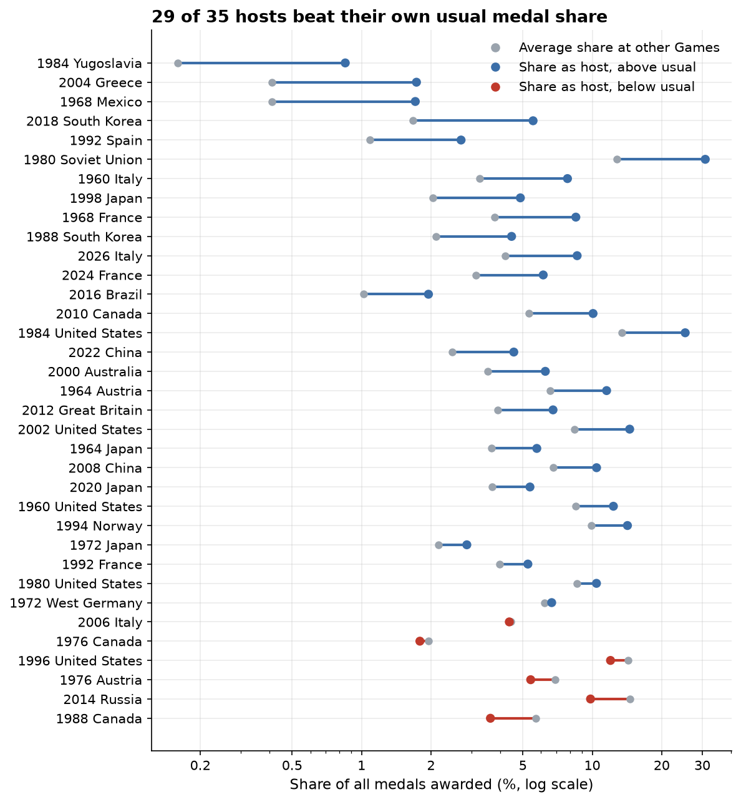
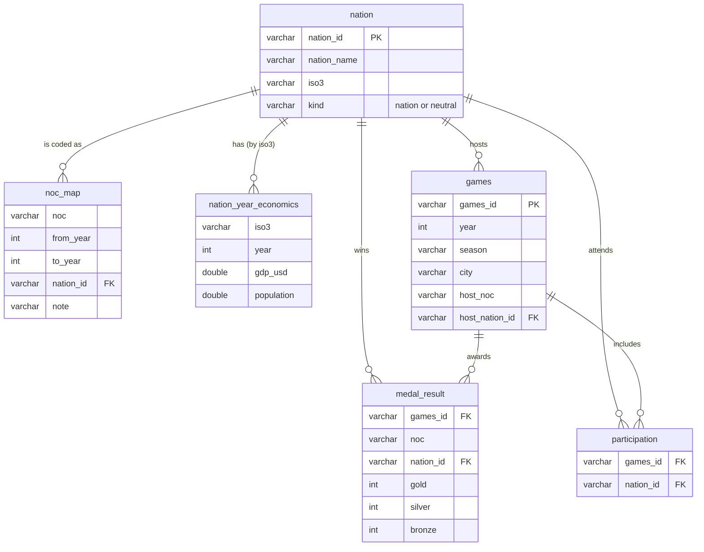
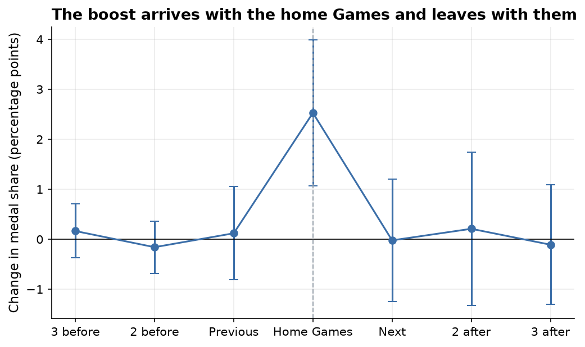
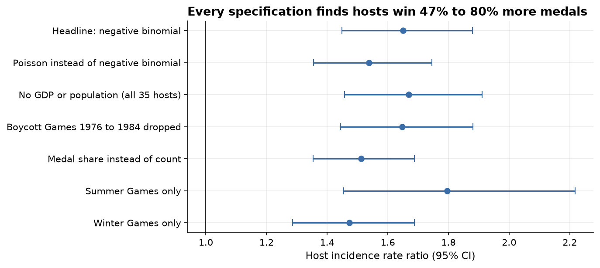

# Does hosting the Games increase a nation's medal haul, and by how much?

[](https://github.com/LA-VS/olympic-host-advantage/actions/workflows/ci.yml)

**Yes. Hosts win about 65% more medals than their own baseline (incidence rate ratio 1.65, 95% CI 1.45 to 1.88)**, across 35 Summer and Winter Games from 1960 to 2026, controlling for GDP, population, the number of medals on offer and each nation's normal level.
The boost arrives with the home Games and, on average, is gone by the next one.



## How to run it

Needs [uv](https://docs.astral.sh/uv/). Everything else, including Python 3.12, is installed by uv from the lock file.

```
git clone https://github.com/LA-VS/olympic-host-advantage.git
cd olympic-host-advantage
uv sync
uv run pytest
uv run python scripts/build_db.py
uv run jupyter nbconvert --execute --to notebook --inplace notebooks/olympic_host_advantage.ipynb
```

The raw data are committed in `data/raw/`. To fetch them again, run `uv run python scripts/fetch_data.py`.
It requests each Wikipedia page at the revision recorded in the manifests, so the data come back identical;
add `--latest` to take today's revisions instead.

## Data

| Data | Source | Licence |
|---|---|---|
| Medal tables, 35 Games | The `{{Medals table}}` template on each "*year season* Olympics medal table" Wikipedia article, read by IOC code, at the revisions in [`medal_tables_manifest.csv`](data/raw/medal_tables_manifest.csv) | [Creative Commons Attribution ShareAlike 4.0](https://creativecommons.org/licenses/by-sa/4.0/) |
| Participating nations | The participants section of each "*year season* Olympics" Wikipedia article, at the revisions in [`participants_manifest.csv`](data/raw/participants_manifest.csv) | As above |
| GDP (`NY.GDP.MKTP.CD`) and population (`SP.POP.TOTL`) | [World Bank World Development Indicators API](https://datahelpdesk.worldbank.org/knowledgebase/articles/889392) | [CC BY 4.0](https://creativecommons.org/licenses/by/4.0/) |
| Host nations | Hand curated in [`data/reference/hosts.csv`](data/reference/hosts.csv), checked automatically against the host flag in every Wikipedia medal table | |
| NOC lineages | Hand curated in [`data/reference/noc_map.csv`](data/reference/noc_map.csv) | |

Medal and participant data were retrieved on 4 November 2026. Medal tables reflect the IOC's reallocations after doping cases as they stood at that date.

### Decisions on nations

IOC codes change, merge and are reused, so every code maps to a nation lineage for a range of years.

* **Russia** includes the Soviet Union, the Unified Team of 1992, OAR (2018) and ROC (2020, 2022). The Individual Neutral Athletes of 2024 and 2026 are not counted as Russia: the nation did not compete.
* **Germany** includes the United Team of 1960 and 1964 and West Germany. East Germany is its own nation with no successor.
* **Serbia** includes Yugoslavia and Serbia and Montenegro; the **Czech Republic** includes Czechoslovakia.
* **ROC** means Taiwan before 1980 and Russia from 2020; the year range decides.
* **Zero medals means "took part and won nothing".** A nation is in the panel only for Games it attended, so boycotts (1976, 1980, 1984, 1988), bans (South Africa 1964 to 1988) and nations that did not exist yet are absent, not zero. Tests check the USA in 1980, the Soviet Union in 1984 and South Africa in 1968.
* 2012 Summer has no participant list on Wikipedia. All 204 NOCs took part, so a nation counts as present if it attended 2008 or 2016.

## Data model

The original coursework stored one table per Games, 16 tables with identical columns. This version uses a normalised schema in DuckDB, built by [`sql/schema.sql`](sql/schema.sql), with the analysis panel as a view in [`sql/panel.sql`](sql/panel.sql).



Analysis queries are kept as `.sql` files: [medal share by nation](sql/medal_share_by_nation.sql), [each host against its other years](sql/host_vs_other_years.sql) and [the event study](sql/event_study.sql).

## Method

**Medal share as well as count.** Medals on offer more than doubled between 1960 and 2024, so raw counts cannot be compared across decades. The descriptive work uses share (a nation's medals over all medals awarded at that Games); the models use counts with Games fixed effects, and share as a robustness check.

**Descriptive.** Each host's share at its home Games against its own average at every other Games of that season, and an event study of the three Games either side of hosting.



On average there is no rise before hosting and the boost is gone by the next Games. The median host stays somewhat above its baseline afterwards (about 1.2 to 1.3 times), so a small legacy for typical hosts is possible; the mean is pulled back by a few large nations.

**Model.** Medals won by a nation at a Games, with:

* **nation fixed effects**, one per nation and season, so each host is compared with its own normal level rather than with other nations
* **Games fixed effects**, which absorb the medals on offer and the season
* **log GDP** and **log population** at the Games year
* a **next host** indicator, because nations often invest ahead of their home Games

Standard errors are clustered by nation. The specification was fixed before the results were seen.
Poisson came first; the Cameron and Trivedi test rejected equal mean and variance (p < 0.001, Pearson dispersion 1.84), so the headline is negative binomial (NB2) with the dispersion estimated by maximum likelihood.

## Findings

1. **Hosts win about 65% more medals than their own baseline** (IRR 1.65, 95% CI 1.45 to 1.88, 33 hostings with economic data).
2. **No measurable rise before hosting.** At the Games before their own, future hosts win 1.08 times their baseline (95% CI 0.95 to 1.23).
3. **Summer hosts gain somewhat more than Winter hosts** (IRR 1.79 against 1.47), but the difference is not statistically clear (p = 0.14).
4. **29 of 35 hosts beat their usual share.** The six that did not include Montreal 1976 and Calgary 1988, where Canada won no gold (Vancouver 2010, its third hosting, beat its usual share), and Sochi 2014, whose count was cut from 33 to 29 by doping reallocations and whose baseline includes the Soviet era.
5. **The effect is robust.** Every alternative specification gives an IRR between 1.47 and 1.80, and removing any single hosting leaves it between 1.60 and 1.69.



| Specification | Hostings | IRR | 95% CI |
|---|---|---|---|
| Headline: negative binomial | 33 | **1.65** | 1.45 to 1.88 |
| Poisson instead of negative binomial | 33 | 1.54 | 1.36 to 1.75 |
| No GDP or population (all 35 hosts) | 35 | 1.67 | 1.46 to 1.91 |
| Boycott Games 1976 to 1984 dropped | 31 | 1.65 | 1.44 to 1.88 |
| Medal share instead of count | 33 | 1.51 | 1.35 to 1.69 |
| Summer Games only | 16 | 1.80 | 1.46 to 2.22 |
| Winter Games only | 17 | 1.47 | 1.29 to 1.69 |

## Limitations

* **Selection into hosting.** Nations that bid are rich and already sporting. Fixed effects remove their usual level, and the GDP and next host terms cover growth and investment, but a nation that wins a bid may also be on an upward path the model cannot see.
* **35 host events.** Enough for a clear average effect, not enough to explain why some hosts gain more than others.
* **Missing economics.** The World Bank has no series for the Soviet Union or Yugoslavia, so Moscow 1980 and Sarajevo 1984 drop out of the headline model. The specification without economic controls keeps all 35 and gives the same answer.
* **Lineage choices.** Counting the Soviet Union as Russia sets a high baseline for Sochi 2014. Other reasonable choices would move individual hosts but not, given the leave one out results, the average.
* **Correlation, not proof of cause.** Comparing each nation with itself rules out the obvious confounders, but this is not an experiment, and medal counts alone cannot separate the mechanisms: crowd support, familiar venues, automatic entry places, events chosen by the host, or judging.

## Next steps

* Separate the mechanisms: compare judged sports with timed ones, and count automatic host entries.
* Model golds on their own, since medal tables rank by gold.
* Add the Paralympic Games, which share host cities and would double the number of events.

## Power BI dashboard

The original coursework included a Power BI report. [`docs/powerbi.md`](docs/powerbi.md) sets out the model, measures and pages for rebuilding it on this schema; `scripts/export_powerbi.py` writes the tables as CSV.

## Repo layout

```
data/raw/                 medal tables, participant lists and World Bank data, never edited by hand
data/reference/           hand curated hosts and NOC lineages
sql/                      schema, analysis panel view and analysis queries
src/olympic_hosts/        fetching, database build, models, chart style
notebooks/                the narrative notebook, outputs saved
reports/figures/          charts used in this README
tests/                    pytest for parsing, the data model and the models
scripts/                  fetch data, build the database, export for Power BI
```

## Origin

This project began as an Olympics SQLite and Power BI project for my Level 4 Data Analyst apprenticeship and was rebuilt to a professional standard:
a normalised data model, data fetched by script from cited sources, more than twice the number of Games, a fixed effects count model in place of descriptive comparison, and tests throughout.
